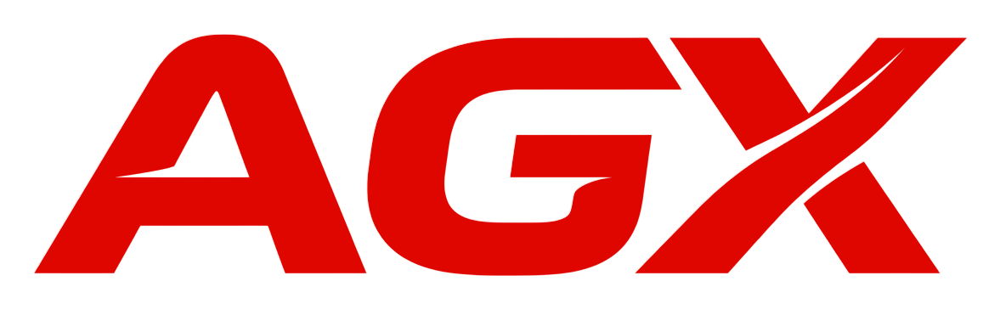

<div align="center">



# Antigravity eXtension (`agx`)

**Enterprise Context Exchange, Session Portability & Security Engine for Google Antigravity**

[](https://github.com/sanjays/antigravity-backup/releases)
[](https://www.rust-lang.org)
[](LICENSE)
[](SECURITY.md)
[](https://github.com/sanjays/antigravity-backup)

<p align="center">
  <a href="#key-features">Key Features</a> •
  <a href="#quickstart">Quickstart</a> •
  <a href="#power-user-suite">Power-User Suite</a> •
  <a href="#security--enterprise-hardening">Security</a> •
  <a href="#documentation">Documentation</a> •
  <a href="#contributing">Contributing</a>
</p>

</div>

---

## Overview

**Antigravity eXtension (`agx`)** is a blazingly fast, cross-platform CLI tool and agent skill engineered for **Google Antigravity**. It enables developers, engineering teams, and AI practitioners to seamlessly backup, export, inspect, diff, query, and migrate Antigravity conversation trajectories, agent memory brains, and custom skills across machines and environments.

By default, Google Antigravity retains conversation trajectories, implementation plans, architectural decisions, and tool transcripts locally (`~/.gemini/antigravity`). When transitioning between workstations, auditing agent actions, or collaborating across engineering teams, that context is locked.

`agx` unlocks that context—packaging single conversations into portable `.agbundle` files or full multi-agent workspaces into `.agproject` archives, hardened with cryptographic integrity checks, automatic secret redaction, and zero-decompression query tooling.

---

## Key Features

- **⚡ Blazingly Fast Rust Core**: Compiled to a zero-dependency standalone native binary with multi-threaded parallel archiving (`rayon`).
- **🛡️ Enterprise-Grade Security**: Automated secret and API key masking (OpenAI, Gemini, Anthropic, AWS, GitHub), Zip-Slip traversal defense, and decompression bomb safeguards.
- **🔍 Zero-Decompression Search (`agx search`)**: Query across archived transcripts, thoughts, and artifacts at terminal speed without unpacking archives to disk.
- **📊 Visual Context Diffing (`agx diff`)**: Compare conversation trajectories, token usage, artifact changes, and implementation plans across sessions.
- **🖥️ Interactive TUI Explorer (`agx explore`)**: Keyboard-driven split-screen terminal interface powered by `ratatui` with live Markdown previews and single-key extraction.
- **🗂️ Whole-Project Bundling (`.agproject`)**: Package multi-session agent contexts along with custom skills (`.agents/skills`), rules (`.agent/rules`), and MCP definitions.
- **🔀 Path Normalization & Cross-OS Portability**: Remaps machine-specific absolute file URIs (`file:///Users/...`, `file:///C:/...`) to relative workspace roots for seamless transfers between macOS, Linux, and Windows.
- **✅ Cryptographic Integrity Auditing (`agx verify`)**: Validates SHA-256 file hashes and sanitizes directory permissions (`0o644` / `0o755`).

---

## Quickstart

### Installation

#### Install via Cargo
```bash
# Clone the repository
git clone https://github.com/sanjays/antigravity-backup.git
cd antigravity-backup

# Install the agx binary globally
cargo install --path .
```

Verify your installation:
```bash
agx --version
# Output: agx 1.0.0-rc.1
```

---

### Basic Usage

#### 1. Interactive Session Export
Export an Antigravity conversation with an interactive fuzzy picker:
```bash
agx export
```

#### 2. Compact Session Export
Generate an ultra-lightweight bundle without bloated tool steps for fast sharing:
```bash
agx export <CONVERSATION_ID> --compact -o session_backup.agbundle
```

#### 3. Inspect Any Archive
Examine metadata, author, step counts, and packaged artifacts without extracting:
```bash
agx info session_backup.agbundle
```

#### 4. Import on Another Machine
Restore a session directly into your target Antigravity brain:
```bash
agx import session_backup.agbundle --as-new-id
```

---

## Power-User Suite

`agx` is built for engineers and power users who need surgical access to agent trajectories and brain artifacts.

### 🔎 Fast Search (`agx search`)
Search transcripts, assistant thoughts, tool calls, and artifacts without decompressing:
```bash
# Case-insensitive keyword search with context lines
agx search my_project.agproject "database migration" -i -C 2

# Regular expression search
agx search session.agbundle "error.*timeout" --regex
```

### 📊 Archive & Session Diffing (`agx diff`)
Identify modified steps, artifact diffs, and transcript evolution between two archives:
```bash
# Detailed visual diff
agx diff session_v1.agbundle session_v2.agbundle

# Summary statistics only
agx diff session_v1.agbundle session_v2.agbundle --stat
```

### 📄 Surgical Extraction & Paging (`agx extract` & `agx cat`)
Extract or view individual files from an archive instantly:
```bash
# Extract only the implementation plan
agx extract session.agbundle artifacts/implementation_plan.md -o ./recovered/

# Stream transcript directly into jq
agx extract session.agbundle transcript.jsonl --stdout | jq '.[] | .type'

# View file with syntax highlighting in terminal
agx cat session.agbundle artifacts/walkthrough.md -n
```

### 🖥️ Interactive TUI Explorer (`agx explore`)
Launch a split-screen terminal browser to inspect files and preview markdown live:
```bash
agx explore my_project.agproject
```

---

## Whole-Project Workspace Exchange (`agx project`)

Share the **entire** development context of an agentic project in a single `.agproject` file: all conversation histories, brain artifacts, skills, rules, and MCP configurations.

```bash
# Export the active workspace project
agx project export -o TeamProject.agproject

# Inspect a project archive
agx project info TeamProject.agproject

# Cryptographically verify the project archive
agx verify TeamProject.agproject

# Import into another developer's environment
agx project import TeamProject.agproject --workspace ~/dev/my-project
```

---

## Security & Enterprise Hardening

`agx` is built with a security-first posture:

| Defense Layer | Mechanism | Protection |
| ------------- | --------- | ---------- |
| **Path Traversal Guard** | Anti-Zip Slip canonicalizer | Rejects relative escapes (`..`), null bytes, and malicious roots. |
| **Expansion Safeguard** | Threshold-limited unpacker | Blocks zip bombs with a 5 GiB uncompressed ceiling & 100:1 ratio limit. |
| **Cryptographic Auditing** | SHA-256 Hash Manifest | Confirms file authenticity and detects tampered bytes via `agx verify`. |
| **Secret Masking** | High-entropy Regex Filter | Redacts API keys (OpenAI, Gemini, Anthropic), AWS keys, SSH/PEM certificates. |
| **Permission Normalization** | Strict POSIX bitmask | Strips setuid/setgid bits; forces `0o644` (files) and `0o755` (directories). |

For vulnerability disclosure, please review [SECURITY.md](SECURITY.md).

---

## Shell Autocompletion

Generate native completions for your shell with `agx completion`:

```bash
# Zsh
agx completion zsh > ~/.zsh/completion/_agx

# Bash
agx completion bash | sudo tee /etc/bash_completion.d/agx

# Fish
agx completion fish > ~/.config/fish/completions/agx.fish
```

---

## Native Antigravity Skill Integration

`agx` operates natively within Google Antigravity as an agent skill.

Invoke it in your Antigravity chat:
> `/backup-session`
> *"Export this conversation as a compact archive for my teammate"*

Skill manifest is located at [`.agents/skills/agx/SKILL.md`](.agents/skills/agx/SKILL.md).

---

## Documentation

Comprehensive guides and technical specifications are available in the [`docs/`](docs/) directory:

- 📖 [**CLI Reference Guide**](docs/cli-reference.md) — Exhaustive documentation for every subcommand, flag, argument, and exit code.
- 🏗️ [**Architecture & Format Specification**](docs/architecture.md) — Specifications for `.agbundle`, `.agproject`, manifest schemas, and security design.
- 🛡️ [**Security Policy**](SECURITY.md) — Security model and responsible vulnerability reporting.
- 🤝 [**Contributing Guide**](CONTRIBUTING.md) — Local development, test suite execution, and PR workflow.
- 📜 [**Changelog**](CHANGELOG.md) — Release notes and version history.
- ⚖️ [**Code of Conduct**](CODE_OF_CONDUCT.md) — Community pledge and standards.

---

## License

Antigravity eXtension (`agx`) is open-source software licensed under the **[Apache License 2.0](LICENSE)**.
