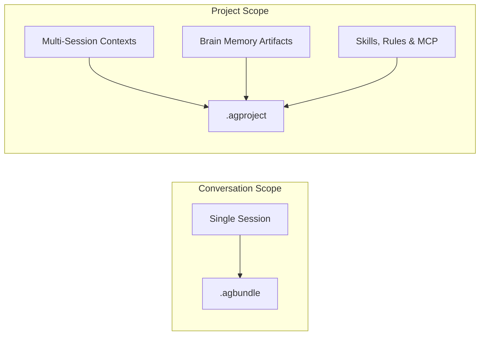
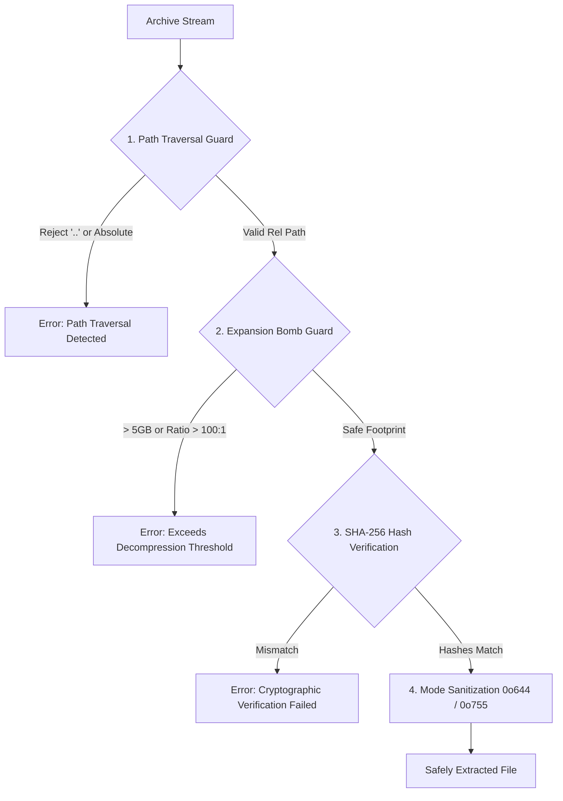
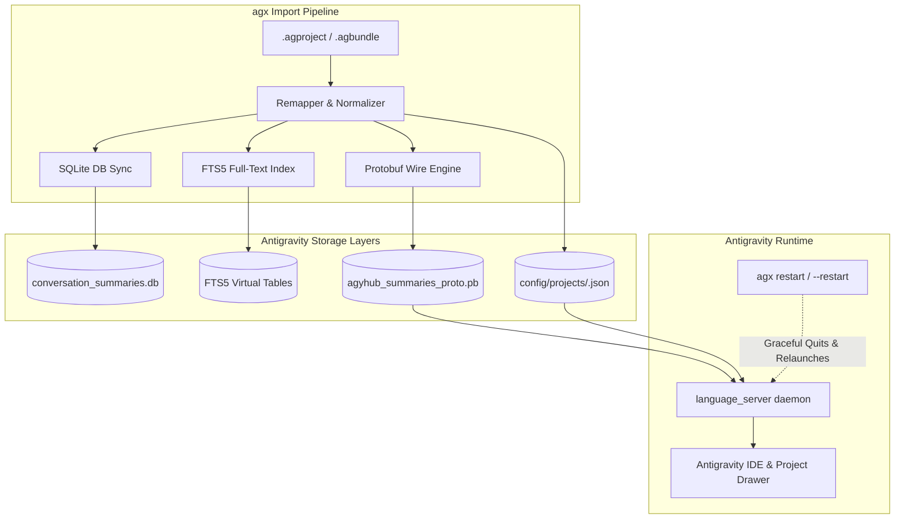

# Antigravity eXtension (`agx`) Architecture & Specification

This document details the internal design, archive format specifications, security defenses, and streaming data flow of **Antigravity eXtension (`agx`)**.

---

## 1. Archive Formats

`agx` introduces two standardized archive specifications for Antigravity state:



### 1.1 Conversation Bundle (`.agbundle`)
A self-contained ZIP archive packaging a single conversation trajectory and its generated brain artifacts.

#### Directory Layout:
```
<session-id>.agbundle
├── manifest.json                  # Cryptographic manifest and metadata
├── transcript.jsonl               # Compact or full execution steps
├── transcript_full.jsonl          # Optional: Full uncompacted steps if generated
└── artifacts/                     # Generated brain artifacts
    ├── architecture.png
    ├── implementation_plan.md
    └── walkthrough.md
```

#### Manifest Schema (`manifest.json`):
```json
{
  "format_version": "1.0",
  "bundle_type": "conversation",
  "created_at": "2026-10-13T13:16:31.482544Z",
  "generator": "agx v1.0.0-rc.1",
  "conversation": {
    "id": "dd1457fe-2440-495a-a27f-d6f891bad9ff",
    "title": "Project Analysis and Summary",
    "step_count": 290,
    "created_at": "2026-10-01T06:05:53Z",
    "sanitized": true,
    "compact": false
  },
  "files": [
    {
      "path": "transcript.jsonl",
      "sha256": "4b92b6a94f08...",
      "size_bytes": 145920,
      "mode": 420
    },
    {
      "path": "artifacts/implementation_plan.md",
      "sha256": "8a31ec19f120...",
      "size_bytes": 12840,
      "mode": 420
    }
  ]
}
```

---

### 1.2 Project Workspace Archive (`.agproject`)
Packages an entire collaborative agent environment across multiple conversation sessions, global/local skills, rules, and MCP definitions.

#### Directory Layout:
```
<project-name>.agproject
├── project_manifest.json          # Workspace metadata, hashes, settings
├── conversations/
│   ├── <session-id-1>/
│   │   ├── manifest.json
│   │   ├── transcript.jsonl
│   │   └── artifacts/
│   └── <session-id-2>/
│       ├── manifest.json
│       ├── transcript.jsonl
│       └── artifacts/
└── customizations/                # Project customizations
    ├── skills/                    # .agents/skills/
    ├── rules/                     # .agent/rules/
    └── mcp/                       # MCP server config
```

---

## 2. Security & Hardening Architecture

`agx` implements four layers of defense-in-depth:



### 2.1 Anti-Zip Slip Path Normalization
Before writing any entry from an archive to the file system, `agx`:
1. Strips any leading slash, Windows drive prefix (`C:`), or root components.
2. Canonicalizes relative segments, explicitly rejecting paths containing `..` or null bytes.
3. Computes the target absolute path and verifies `target.starts_with(safe_root)`.

### 2.2 Decompression Bomb Safeguards
To protect CI/CD nodes and workstations against archive denial-of-service:
- **Maximum Archive Expansion**: Cumulative uncompressed bytes cannot exceed `MAX_EXPANSION_BYTES` (default: 5 GiB).
- **Compression Ratio Check**: Warns or aborts if uncompressed:compressed ratio exceeds 100:1.
- **Max File Count**: Bounds the number of directory entries to 100,000 files per archive.

### 2.3 Automated Secret Redaction
When exporting, files are scanned via streaming regex patterns before writing to the ZIP archive. Matched patterns are replaced with `[REDACTED_SECRET:<type>]`:
- API Keys: Gemini / Google Cloud, OpenAI, Anthropic, GitHub Personal Access Tokens.
- Cloud Credentials: AWS Access Key ID, AWS Secret Access Key.
- Certificates / Keys: RSA / EC / OpenSSH PEM headers.

### 2.4 Cryptographic Verification (`agx verify`)
Every archive packages SHA-256 hashes for every file. The `agx verify` subcommand reads the archive in a single pass:
- Recalculates file SHA-256 checksums on the fly.
- Verifies that zero extraneous or modified files exist within the archive.
- Confirms file permission bits are canonicalized to standard POSIX permissions (`0o644` for files, `0o755` for directories).

---

## 3. Query Engine Architecture

The power-user commands (`agx search`, `agx cat`, `agx extract`, `agx diff`) operate directly against ZIP central directories:

- **Zero Full Extraction**: Operations unpack individual files into in-memory buffers or stream them directly without touching the host filesystem.
- **Fast Search Indexing**: Transcripts are streamed line-by-line via JSON parser iterators, matching user input, thinking steps, and tool responses with minimal memory footprint.
- **Syntax Highlighting**: `agx cat` dynamically identifies MIME types and file extensions, applying ANSI 256-color palettes directly in the terminal pager.

---

## 4. Storage Synchronization & IDE Lifecycle Engine



### 4.1 Dual-Storage Synchronization
Antigravity operates a hybrid storage layer:
1. **SQLite Database (`conversation_summaries.db`)**: Stores indexed conversation summaries and metadata.
2. **FTS5 Virtual Search Table**: Indexes prompt snippets and chunks for instant fuzzy search across sessions.
3. **Protobuf Store (`agyhub_summaries_proto.pb`)**: A binary Protobuf `SummariesState` (`CascadeTrajectorySummaries`) read by the Go `language_server` daemon (`subclient_type hub`).
4. **Project Configs (`config/projects/<id>.json`)**: Defines project identities, resource git folders, and permission policies.

`agx` implements a zero-dependency binary Protobuf parser and serializer (`summaries_pb.rs`) that unpacks protobuf wire format, performs collision-free UUID remapping, synthesizes missing summary blobs, and synchronizes both SQLite and Protobuf stores atomically upon import.

### 4.2 IDE Daemon Lifecycle & Automatic Restart
- The `language_server` daemon caches summaries and project associations in memory upon startup (`trigger=startup`).
- Electron window reloads (`Cmd+R`) only refresh the renderer webview and reattach to the running daemon without reloading disk state.
- `agx` introduces cross-platform graceful restart orchestration:
  - **macOS**: Gracefully quits the application via AppleScript (`tell app "Antigravity" to quit`), polls for process termination, and relaunches via `open -a Antigravity` (restoring workspace tabs).
  - **Linux**: Signals `SIGTERM` to the process group, ensures file lock release, and respawns the binary.
  - **Windows**: Executes graceful termination via `taskkill /IM Antigravity.exe` and relaunches the process.
- Can be triggered automatically via `--restart` (`--auto-restart`) or manually with `agx restart`.
