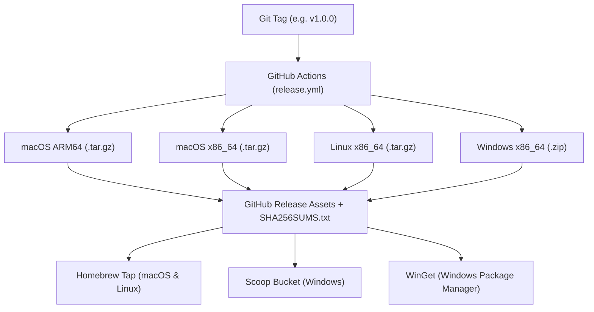

# Multi-Platform Packaging & Distribution Guide

This guide details how to distribute **Antigravity eXtension (`agx`)** across **macOS**, **Linux**, and **Windows** using **Homebrew**, **Scoop**, **WinGet**, and direct binary GitHub Releases.

---

## Architecture Overview



---

## 1. Homebrew Distribution (macOS & Linux)

Homebrew is the standard package manager on macOS and is widely used on Linux via Homebrew on Linux (Linuxbrew).

### Option A: Custom Tap (Recommended)

A custom tap allows users to install `agx` immediately via:
```bash
brew tap imsaba16/agx
brew install agx
```
or in a single command:
```bash
brew install imsaba16/agx/agx
```

#### Step 1: Create the Tap Repository
1. In your GitHub account or organization, create a new public repository named:
   `homebrew-agx` or `homebrew-tap` (e.g., `github.com/<your-username>/homebrew-agx`).
2. Inside that repository, create a directory called `Formula/`.

#### Step 2: Create `Formula/agx.rb`
Add the following Ruby formula file:

```ruby
class Agx < Formula
  desc "Context exchange, session diffing, search, and backup engine for Google Antigravity"
  homepage "https://github.com/imsaba16/agx"
  version "1.0.0-rc.2"
  license "Apache-2.0"

  on_macos do
    on_arm do
      url "https://github.com/imsaba16/agx/releases/download/v#{version}/agx-macos-arm64.tar.gz"
      sha256 "<SHA256_OF_MACOS_ARM64_TAR_GZ>"
    end
    on_intel do
      url "https://github.com/imsaba16/agx/releases/download/v#{version}/agx-macos-x86_64.tar.gz"
      sha256 "<SHA256_OF_MACOS_X86_64_TAR_GZ>"
    end
  end

  on_linux do
    on_intel do
      url "https://github.com/imsaba16/agx/releases/download/v#{version}/agx-linux-x86_64.tar.gz"
      sha256 "<SHA256_OF_LINUX_X86_64_TAR_GZ>"
    end
  end

  def install
    bin.install "agx"

    # Generate and install shell completions
    generate_completions_from_executable(bin/"agx", "completion")
  end

  test do
    assert_match "agx #{version}", shell_output("#{bin}/agx --version")
  end
end
```

#### Step 3: Automate Homebrew Tap Updates via GitHub Actions
To automatically update `Formula/agx.rb` whenever you push a new release tag:
1. Create a GitHub Personal Access Token (classic with `repo` scope, or fine-grained with write access to `homebrew-agx`).
2. Save it as a repository secret: `HOMEBREW_TAP_TOKEN` in `antigravity-backup`.
3. Add a step to your release workflow or use the `mislav/bump-homebrew-formula-action`:

```yaml
- name: Update Homebrew Formula
  uses: mislav/bump-homebrew-formula-action@v3
  with:
    formula-name: agx
    homebrew-tap: imsaba16/homebrew-agx
    base-branch: main
    download-url: https://github.com/imsaba16/agx/releases/download/${{ github.ref_name }}/agx-macos-arm64.tar.gz
  env:
    COMMITTER_TOKEN: ${{ secrets.RELEASE_TOKEN }}
```

---

## 2. Windows Distribution

### Option A: Scoop (Developer Favorite)

Scoop installs command-line programs to the user's home directory without UAC admin prompts.

#### Installation Command for Users:
```powershell
scoop bucket add agx https://github.com/imsaba16/scoop-bucket
scoop install agx
```

#### Setup:
1. In your `imsaba16/scoop-bucket` repository:
2. Inside `bucket/agx.json`:

```json
{
  "version": "1.0.0-rc.2",
  "description": "Context exchange, session diffing, search, and backup engine for Google Antigravity",
  "homepage": "https://github.com/imsaba16/agx",
  "license": "Apache-2.0",
  "architecture": {
    "64bit": {
      "url": "https://github.com/imsaba16/agx/releases/download/v1.0.0-rc.2/agx-windows-x86_64.zip",
      "hash": "<SHA256_OF_WINDOWS_ZIP>"
    }
  },
  "bin": "agx.exe",
  "checkver": "github",
  "autoupdate": {
    "architecture": {
      "64bit": {
        "url": "https://github.com/imsaba16/agx/releases/download/v$version/agx-windows-x86_64.zip"
      }
    }
  }
}
```

---

### Option B: WinGet (Official Windows Package Manager)

WinGet is built into Windows 11 and Windows 10.

#### Installation Command for Users:
```powershell
winget install agx
```

#### Setup:
Use Microsoft's official `wingetcreate` CLI tool:
```powershell
# Install wingetcreate
winget install wingetcreate

# Generate manifest from release URL
wingetcreate new https://github.com/<your-username>/antigravity-backup/releases/download/v1.0.0-rc.2/agx-windows-x86_64.zip
```
Follow the interactive prompts; `wingetcreate` automatically tests the manifest and creates a PR to `microsoft/winget-pkgs`.

---

## 3. Direct Binary Installation (All Platforms)

Users can always download and install standalone pre-compiled binaries directly from GitHub Releases:

### macOS / Linux One-Liner (curl):
```bash
curl -fsSL https://raw.githubusercontent.com/<your-username>/antigravity-backup/main/scripts/install.sh | bash
```

### Windows One-Liner (PowerShell):
```powershell
irm https://raw.githubusercontent.com/<your-username>/antigravity-backup/main/scripts/install.ps1 | iex
```

---

## Release Checklist

1. Update version in `Cargo.toml` (e.g. `1.0.0`).
2. Update `CHANGELOG.md` with release notes.
3. Commit and tag the release:
   ```bash
   git tag -a v1.0.0 -m "Release v1.0.0"
   git push origin v1.0.0
   ```
4. GitHub Actions will:
   - Build macOS ARM64 & Intel (`.tar.gz`).
   - Build Linux x86_64 (`.tar.gz`).
   - Build Windows x86_64 (`.zip`).
   - Calculate and publish `SHA256SUMS.txt`.
   - Publish GitHub Release assets.
5. Homebrew formula and Scoop manifest update with the new version and hashes.
